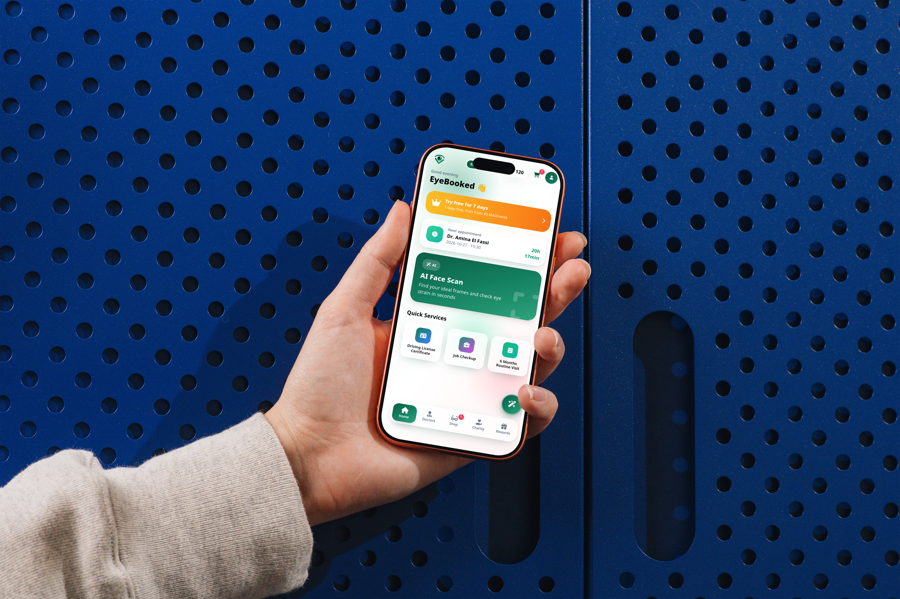
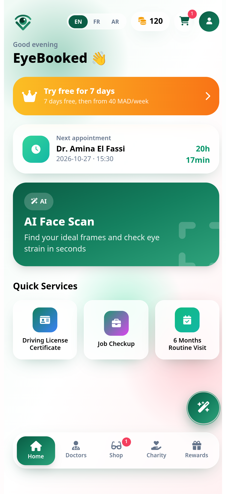
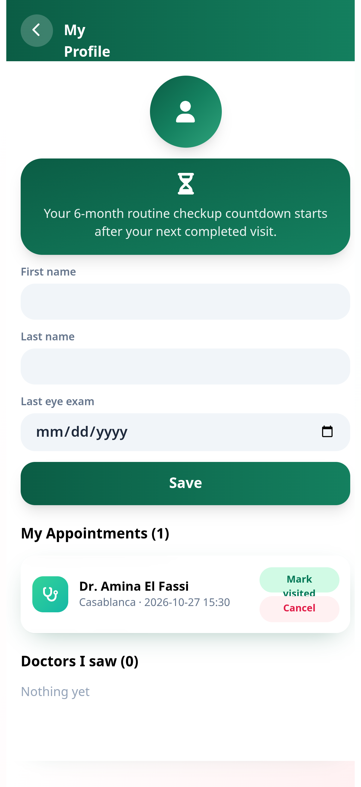
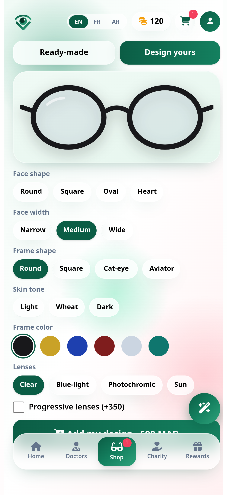
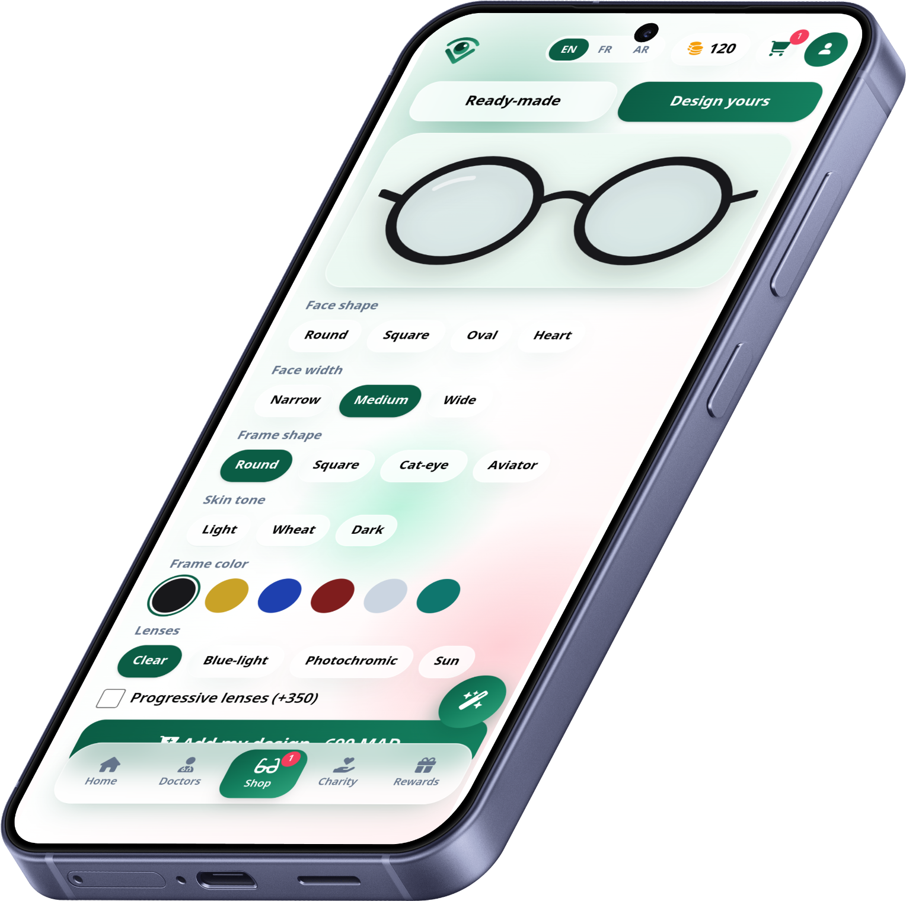
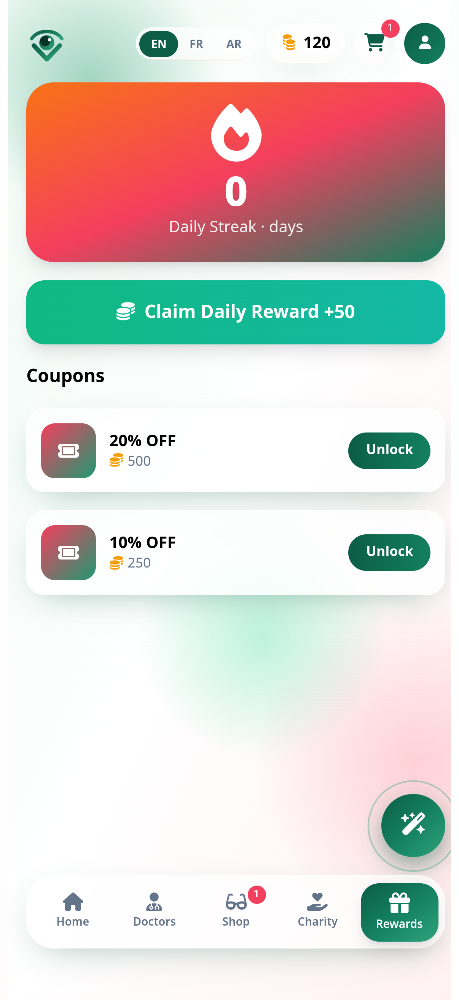
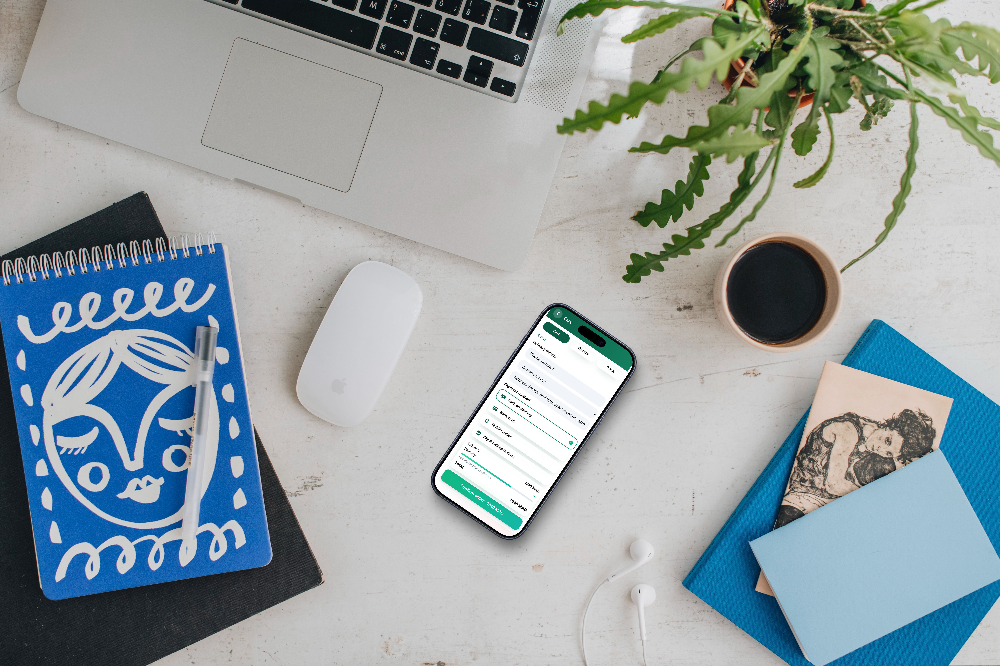

# EyeBooked

## Your eye care, booked. · Mobile App Preview

**Eye care booking · AI frame recommendations · Glasses shop · Rewards**  
**English · Français · العربية (RTL support) · Morocco (MAD)**

> Product concept preview. Demo screens only; no real payments or live clinical/AI integrations are represented.

---

## 1 · Login / Sign in

A simple entry point for an eye-care experience, with email or phone and password sign-in.

- EyeBooked
- Your eye care, booked.
- Email or phone
- Password
- Sign in

## 2 · Home Dashboard

A personalized home screen brings appointments, eye-care actions and discovery together.

- Good afternoon
- Try free for 7 days
- 7 days free, then from 40 MAD/week
- AI Face Scan: find frame inspiration and get eye-strain tips
- Quick Services: driving licence and routine checkup

## 3 · Find Doctors

Search and book eye-care professionals by proximity and city. Sample demo profiles include:

- Dr. Amina El Fassi · Casablanca · Maarif · ★ 4.9
- Dr. Youssef Bennani · Casablanca · Gauthier · ★ 4.8
- Dr. Salma Idrissi · Casablanca · Ain Diab · ★ 4.7
- Dr. Karim Alaoui · Rabat · Agdal · ★ 4.9

The product concept targets a catalog of 30+ ophthalmologists across major Moroccan cities; the current profile screen demonstrates appointment management, while doctor listings use sample data.

## 4 · Glasses Shop

Browse ready-made eyewear or explore custom frame design, including progressive lens options.

- Ray-Ban RX6489 · 1,090 MAD
- Persol PO3007V · 1,690 MAD
- Clubmaster · 950 MAD
- Oakley OX8046 · 890 MAD

## 5 · Rewards & Eye Health

A loyalty layer and practical eye-health tools help make routine care easier to revisit.

- Daily streaks, coupons and free-Friday consultation promotions
- 20-20-20 rest timer
- Amsler grid self-check
- Charity concept: sponsor free eye exams for low-income patients

## 6 · Checkout & Order Tracking

A guided cart experience for eyewear orders, with order status stages envisioned from preparation through delivery.

## 7 · Mobile-first & Multilingual

Designed for a phone-sized experience and prepared for English, French and Arabic, including right-to-left layout support. Prices and examples are Morocco-focused and shown in MAD.

## Product scope

**Demo · No real payments · Morocco-focused (MAD)**

The current build is a front-end prototype. Authentication, booking, AI recommendations, checkout, rewards, and live order tracking require production services and integrations before launch.
